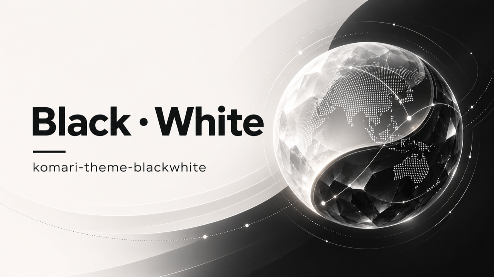
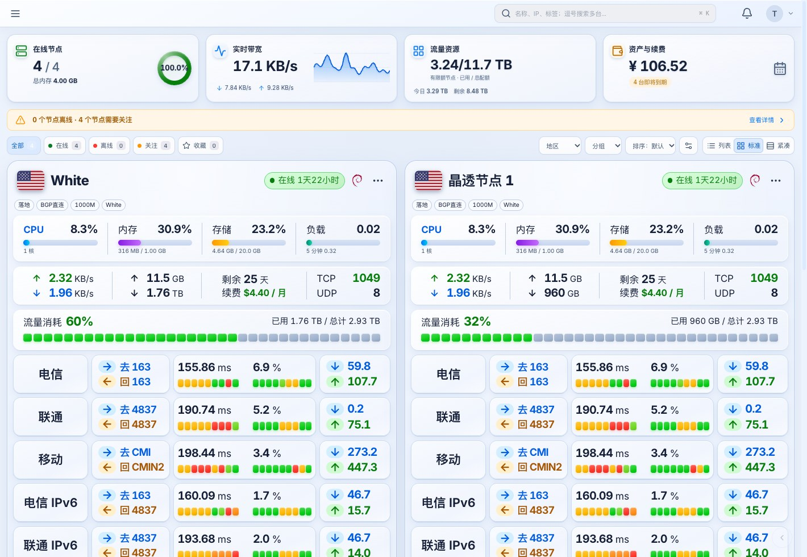
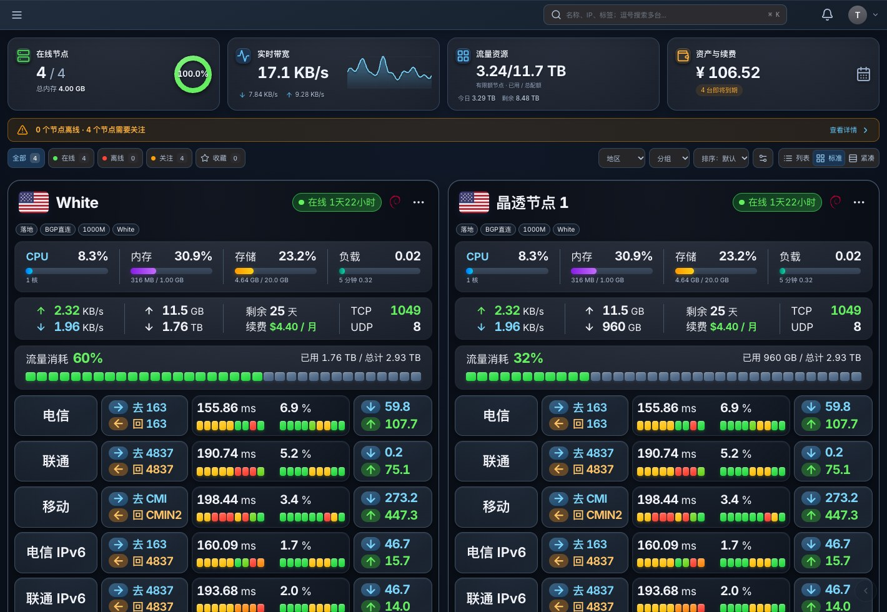
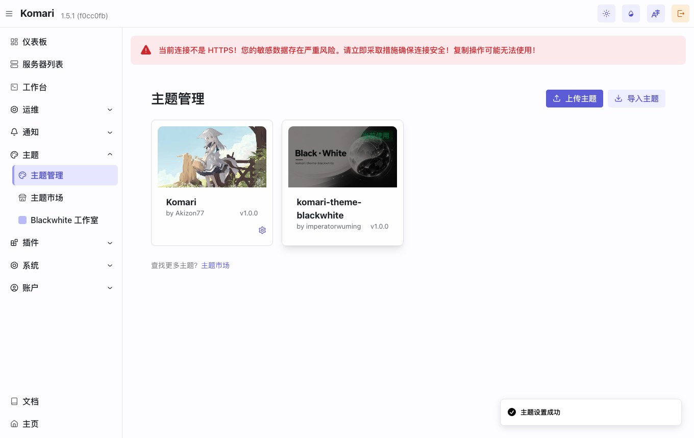
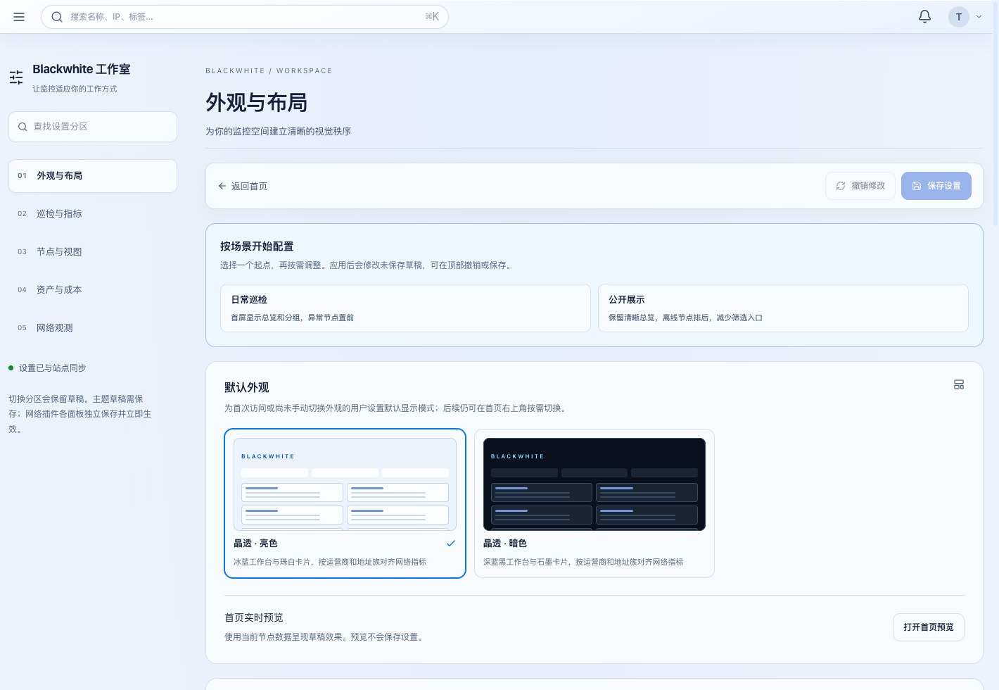
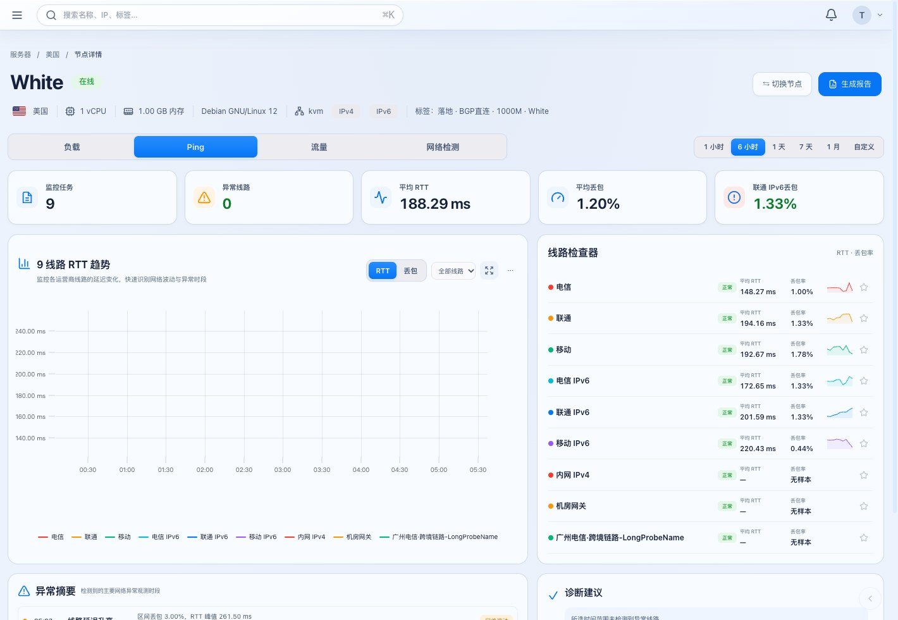
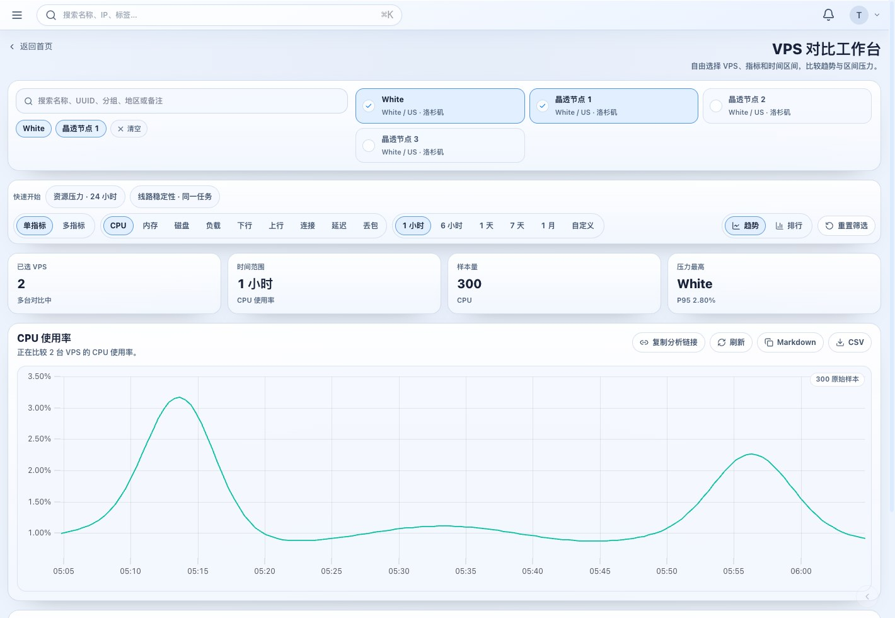
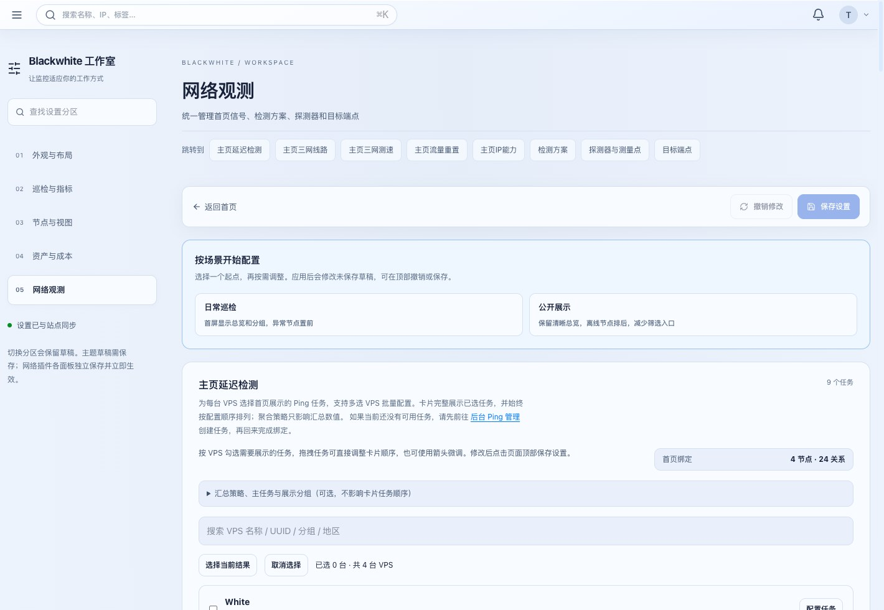
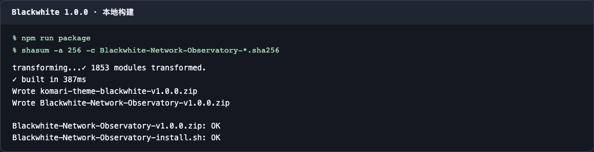

# komari-theme-blackwhite



komari-theme-blackwhite 是 Komari 的服务器监控和资产管理主题。**晶透·亮色**与**晶透·暗色**共用同一套功能，包括节点巡检、负载与流量趋势、多 VPS 对比、资产与续费统计、网络观测和报告导出。

**当前版本 v1.0.0** · [下载 ZIP 和安装脚本](https://github.com/imperatorwuming/komari-theme-blackwhite/releases/tag/v1.0.0) · [安装主题](#安装主题) · [配置网络观测](network-observatory/README.md) · [后端兼容性](COMPATIBILITY.md)

| 晶透·亮色 | 晶透·暗色 |
| --- | --- |
|  |  |

## 安装主题

1. 先部署 [Komari 服务端](https://www.komari.wiki/) 并登录后台。如果侧栏是英文，Theme Management 对应「主题管理」。要看到 CPU、内存、在线状态等基本数据，请先在「服务器列表」添加至少一个服务器，按后台生成的命令安装官方 [Komari Agent](https://github.com/komari-monitor/komari-agent)，等服务器显示在线。
2. 从 [v1.0.0 的 Assets](https://github.com/imperatorwuming/komari-theme-blackwhite/releases/tag/v1.0.0) 下载 **`komari-theme-blackwhite-v1.0.0.zip`**。
3. 在后台打开 **主题 → 主题管理 → 上传主题**，选择 ZIP，页面会自动上传。直接上传完整 ZIP，解包后上传会缺少安装清单。Release 页面的自动生成源码包也无法安装。
4. 在已安装列表中找到 **komari-theme-blackwhite**，将其设为当前主题。点击左下角「主页」验证，已有节点和历史数据仍由同一个 Komari 服务端提供。



**更新同名主题**时可覆盖上传对应 Release ZIP。新安装时，如果面板已有其他主题，可先导出面板备份，再安装并切换；主题设置以主题标识存放，需要在 Blackwhite 工作室重新确认。

## 配置外观与首页

登录后进入 **Blackwhite 工作室**，或直接访问 `/?view=theme-manage`。在「外观与布局」选择站点默认的晶透亮色或暗色，并可分别设置桌面和手机的紧凑卡片、标准卡片或列表。背景支持按色调和设备设置，时区使用浏览器时区或指定 IANA 时区。先用「打开首页预览」确认草稿，再点击「保存设置」。首页右上角浮动菜单可保存个人外观选择，卡片布局切换仅影响当前会话。

「巡检与指标」可以设置首页总览、节点分组次序、离线节点排序、标签及保存视图。「资产与续费」可选成本统计范围、汇率来源和快捷入口。「网络观测」负责首页 Ping 绑定以及可选的网络探测。



## 巡检、实例与对比

- 首页可以按状态、地区和分组筛选，也支持关键词、收藏以及按保存视图筛选。顶部资源板块可打开在线、流量、带宽、到期或成本明细。使用列表查看及排序多列指标。
- 点击任一节点进入实例，使用「负载」「Ping」「流量」「网络检测」等标签切换工作区。按图表提供的预设范围查询，或指定开始和结束时间。显示范围会受 Komari 的记录保留期约束。
- 打开「VPS 对比」或使用首页的对比入口，选择至少两个 VPS，按需切换负载、流量、Ping 延迟和丢包等指标。调整时间范围后可保存工作预设。
- 在实例页面点击「生成报告」，查看趋势、网络证据和检测历史。可导出独立 HTML、打印为 PDF，或下载支持的检测图片及 ZIP。检测配置和样例见 [网络报告使用指南](docs/network-reports.md)。

| 单台实例的网络质量 | 多 VPS 对比 |
| --- | --- |
|  |  |

## 接入网络观测

基本监控和 Komari 原生 Ping 可直接使用。要在首页和实例查看三网去回程、上下行测速、IP 质量、流媒体和 AI 解锁，以及 TcpQuality / NodeQuality 完整报告，请依次安装 **Blackwhite 网络观测插件**、在参与检测的 VPS 上安装 **Blackwhite 探测器**、创建检测方案并验证一轮。主题、插件和探测器的项目版本均为 **1.0.0**。



完整过程见 [网络观测图文教程](network-observatory/README.md)，包括公网访问、安装命令、设备接入、方案定时、发布范围和排障。截图中的监控指标和网络结果为示例数据。

## 构建与验证

安装 Node.js 22 或更高版本、Python 3 和 Chrome / Chromium，从仓库根目录运行以下命令。插件运行时另需 Go，Alpine 服务测试另需 Docker。

```sh
npm ci
npm run test:release-gates
npm run test:plugin-runtime
npm run package
npm run test:alpine-runner
```



主题构建输出在 `dist/`。打包会在项目根目录生成主题 ZIP、网络观测 ZIP、安装脚本及探测器包校验文件。[Komari 文档](https://www.komari.wiki/dev/theme) · [Komari Monitor](https://github.com/komari-monitor/komari) · [Komari Agent](https://github.com/komari-monitor/komari-agent)

## 来源与致谢

主题基于 LuminaPlus 与 Lumina 的工作延续开发。感谢 shark、shanyang 及各上游贡献者，也感谢 Komari 社区主题提供的设计和实现参考。[LuminaPlus](https://github.com/shanyang242/Komari-Theme-LuminaPlus) · [Lumina](https://github.com/stqfdyr/komari-theme-Lumina)
