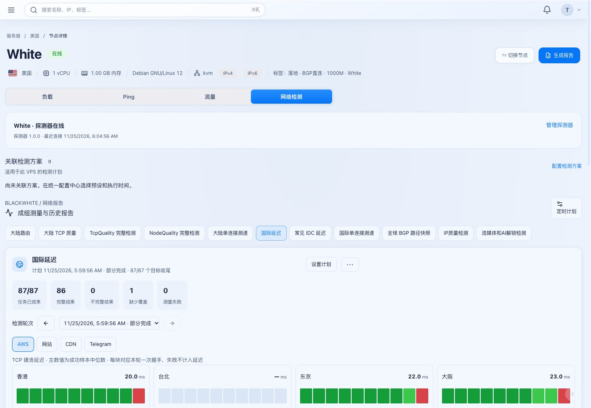
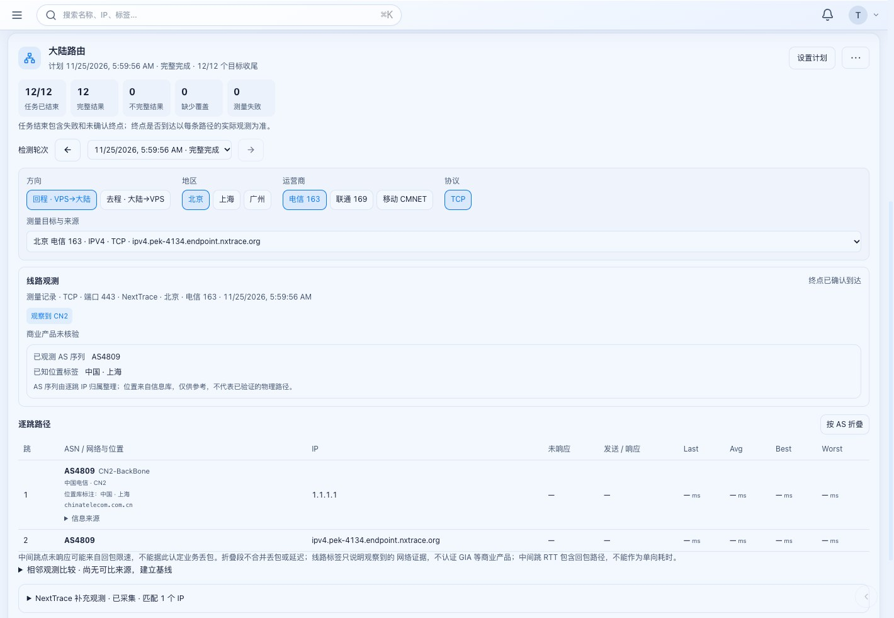
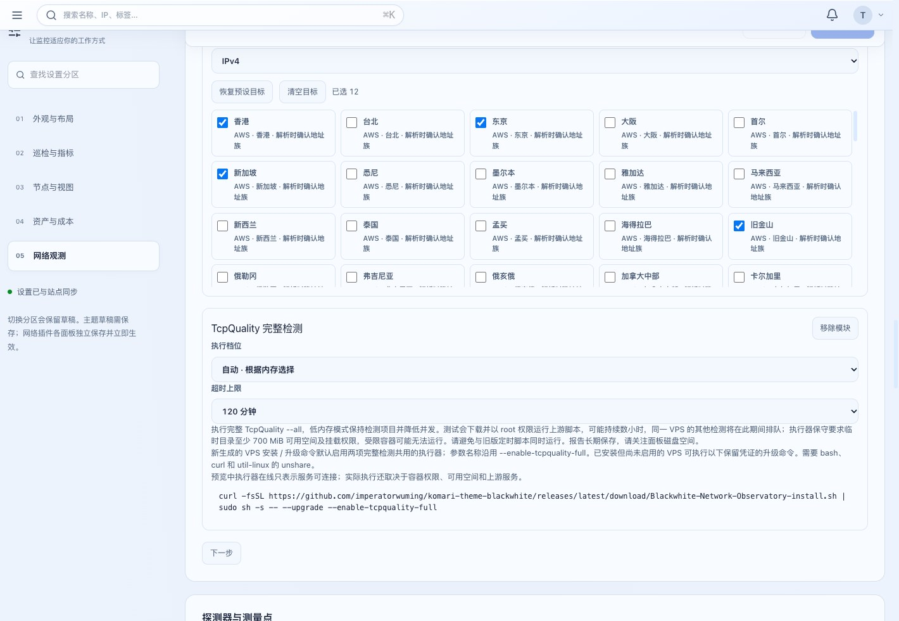
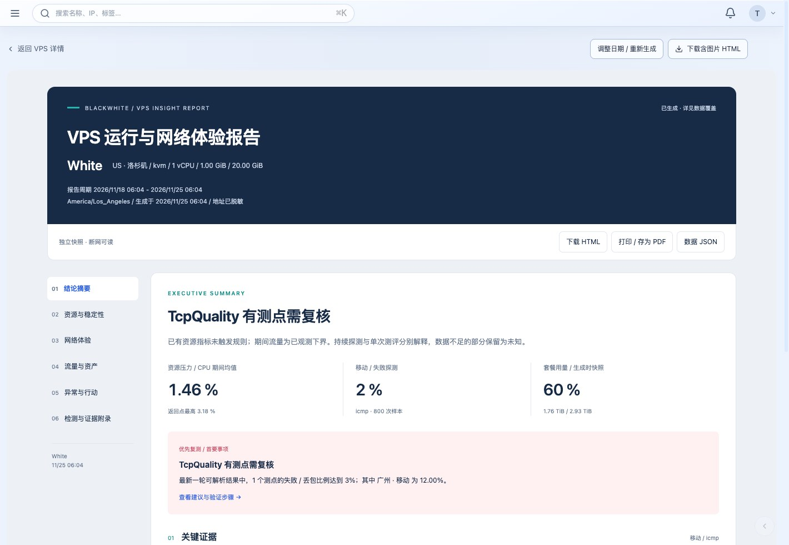

# Blackwhite 网络报告使用指南

## 从实例打开网络检测

点击首页 VPS →「网络检测」。页面顶部显示已关联方案与执行状态，管理员可对当前 VPS 跑一轮。切换方案或模块，再选择时间与轮次。先读状态和样本数，然后查看各目标的失败原因、去回程证据或历史趋势。

## 读懂主要结果

- Ping / TCP 同时看尝试次数、延迟和失败状态。TCP 建连失败与 ICMP 丢包含义不同。
- 线路在报告里可切换去程、回程、地区、运营商和协议。公共测量点按可用网络匹配，证据可能覆盖部分地区。
- 吞吐量按方向、地址族、测量点和连接数解释。先确认 P1 单连接、采样时长和收发方；显示为部分完成时保留已取得的数据。
- IP 质量和解锁按不同数据库、IPv4 / IPv6 与检测方式分别查看。数据库结果和解锁判定会随源 IP、DNS 和时间变化。

## 完整检测

两项完整检测均由可选的本机特权执行器执行上游程序，建议先在一台有空闲资源且有授权的 VPS 上试跑。启动后可能持续较长时间，同机其他测试可能排队。

| 项目 | 设置与前置条件 |
| --- | --- |
| TcpQuality | AUTO / FULL / LOWMEM，超时 30–150 分钟。执行目录至少 700 MiB、需相关挂载能力。LOWMEM 降低并发 |
| NodeQuality | 可选硬件质量、IP 质量、网络质量、回程路由。支持硬件标准 / 快速 / 深度和网络标准 / 低流量，超时 30–180 分钟，执行目录至少 1.5 GiB。上游会上传报告并生成第三方可访问链接 |

打开对应模块看在线报告、可用 CSV、原始终端文本和失败诊断；第三方页面受各自保留规则约束，面板中的原始结果以保存的轮次为准。

## 导出与分享

从实例点击「生成报告」。确认时间范围、章节和结果样式后，再使用报告页面的导出按钮。统一图表版按结构化测量结果排版，上游原始版保留已有的 TcpQuality SVG 分区和 NodeQuality ANSI 日志。可下载支持的 PNG 或 ZIP、报告数据 JSON，导出独立 HTML，或通过打印保存为 PDF。导出文件及分享链接应按实际内容决定公开范围。

