# Blackwhite 网络观测安装与配置

适用于 **komari-theme-blackwhite 1.0.0、Blackwhite 网络观测插件 1.0.0 和 Blackwhite 探测器 1.0.0**。开始前请先[安装主题并接入 Komari Agent](../README.md#安装主题)。插件依赖支持 JavaScript 插件的 Komari，建议使用通过本项目验证的官方 1.5.1。

| 部署位置 | 组件与职责 |
| --- | --- |
| Komari 面板 | 主题显示数据，网络观测插件保存配置、派发任务并收集结果 |
| 每台参与检测的 VPS | Komari Agent 上报服务器指标，Blackwhite 探测器执行网络测量。两者可并存 |
| 可选，中国大陆网络 | 独立测量点从本网络主动测试 VPS，供自建去程线路或受控上行、下行测试使用 |

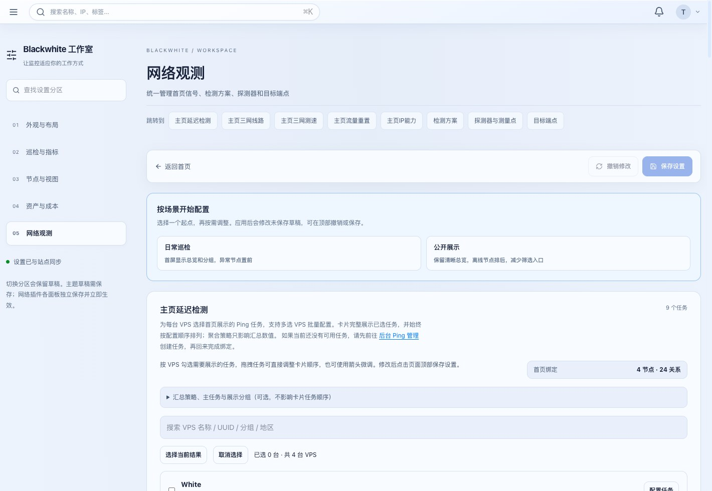

## 1. 安装面板插件

1. 在 [Release v1.0.0](https://github.com/imperatorwuming/komari-theme-blackwhite/releases/latest) 的 Assets 下载 **`Blackwhite-Network-Observatory-v1.0.0.zip`**。也可以下载同名 `.sha256`，在两份文件同一目录用 `sha256sum -c Blackwhite-Network-Observatory-v1.0.0.zip.sha256` 核验。
2. 登录 Komari 管理后台，进入 **插件 → 插件管理**，上传完整 ZIP。安装后打开插件的启用开关，检查权限内容并授权。
3. 插件声明 Node 兼容运行环境、自定义 API 路由及系统 RPC 权限，其中系统 RPC 用于读取节点清单与管理员信息，检测由独立探测器本地执行。启用后确认插件状态为运行中，再回到主题的 **Blackwhite 工作室 → 网络观测**。
4. 正式面板应使用探测器能够访问且证书有效的 **HTTPS** 地址。若使用反向代理，将面板页面和 `/api/blackwhite-network-observatory/` 一并转发到 Komari。确保 VPS 能访问该面板、GitHub 发布页与所选检测目标。

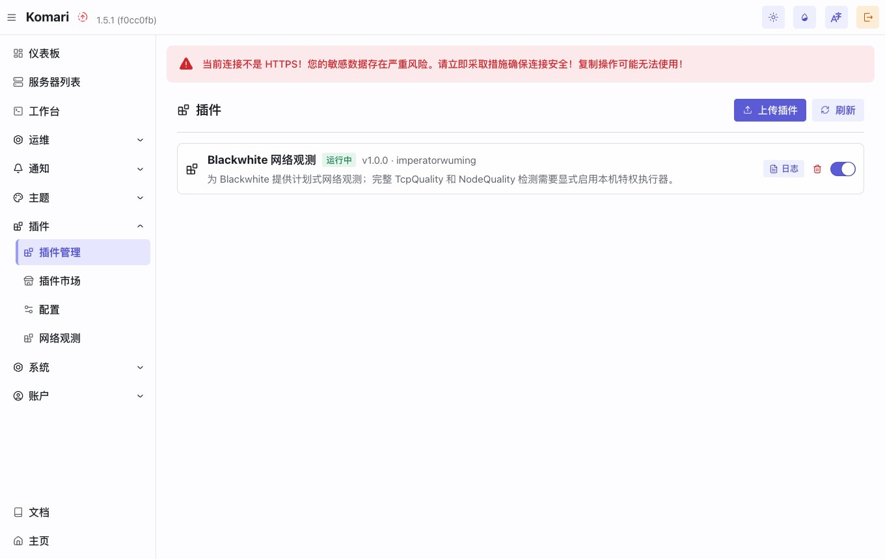

## 2. 在 VPS 安装探测器

1. 打开 **网络观测 → 探测器与测量点**。在「VPS 探测器」选择与当前 VPS 对应的节点。新节点显示「未接入」。选择安装模式（自动、轻量或完整），再点「生成 VPS 接入凭证」。
2. 复制安装命令。SSH 登录该 VPS，在普通用户的 shell 粘贴并执行；命令使用 `sudo`，需要管理员权限。若在 Alpine 以 root 登录，将命令中的 `sudo` 去掉。脚本会从发布页下载包并核验 SHA-256。
3. 按提示输入节点专属探测器密钥。终端输入密钥时不回显。**保存好密钥并避免把它写入命令、日志、截图或工单。** 它不同于 Komari Agent 的节点 Token。首次安装后等待一个心跳周期，回到此页确认「在线」、版本 `1.0.0` 和所需能力。
4. 推荐检查本机服务，并保留完整安装输出方便排障：

```sh
# Debian / Ubuntu / 其他 systemd 系统
sudo systemctl status blackwhite-network-observatory-agent.service
sudo journalctl -u blackwhite-network-observatory-agent.service -n 50 --no-pager

# Alpine / OpenRC（以 root 执行）
rc-service blackwhite-network-observatory status
rc-status default
```

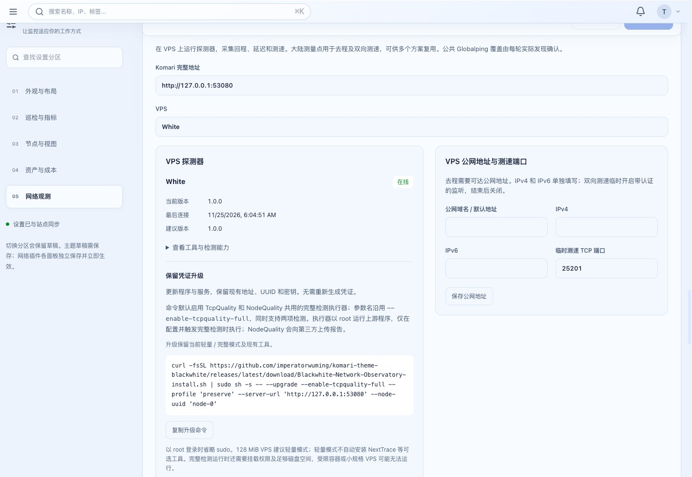

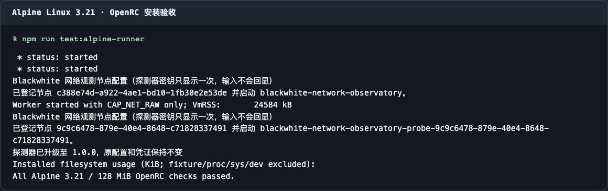

### 安装参数与升级

如果想查看安装脚本后再执行，可先把它保存到文件。将下列地址与 UUID 换成面板提供的值，密钥仍在交互提示中输入。

```sh
release=https://github.com/imperatorwuming/komari-theme-blackwhite/releases/latest/download
curl -fSLO "$release/Blackwhite-Network-Observatory-install.sh"
curl -fSLO "$release/Blackwhite-Network-Observatory-install.sh.sha256"
sha256sum -c Blackwhite-Network-Observatory-install.sh.sha256
sudo sh Blackwhite-Network-Observatory-install.sh \
  --profile lite --server-url 'https://monitor.example.com' --node-uuid '你的节点 UUID'
```

| 模式 | 适用情况 |
| --- | --- |
| `auto` | 默认按内存与根分区空间选择。有效内存不超过 192 MiB，或根分区剩余小于 192 MiB 时选轻量 |
| `lite` | 安装基础依赖，适合先做 TCP 延迟和 MTR 线路。并发较低。依赖 iperf3、NextTrace 或 nping 的功能需要另外具备相应工具 |
| `full` | 安装更多工具，适合受控吞吐、附加线路元数据或原始 SYN 质量。功能仍取决于主机网络、工具和挂载权限 |
| `preserve` | 与 `--upgrade` 配合，保留已有安装模式和凭证。优先用界面的「复制升级命令」 |

工作室生成的 **VPS** 命令含 `--enable-tcpquality-full`，该参数同时启用 TcpQuality、NodeQuality 共用的本机特权执行器。只做轻量检测时可删去该参数。自动更新默认关闭，可在探测器界面单独允许。密钥泄露或丢失时走「凭证管理 → 重置」，随后在同一 VPS 写入新密钥。重置会立即使旧密钥失效。


## 3. 配置首页 Ping 和三网显示

1. 在 **Komari 后台 → 运维 → 延迟监测** 新建 Ping 任务。给任务起清楚的名字（例如「上海电信 IPv4」），按后台可用的选项填写地址、检测类型和间隔，选择发起检测的服务器。确保这些目标允许被监测。
2. 返回 **Blackwhite 工作室 → 网络观测 → 主页延迟检测**。可逐台绑定任务，也可搜索并批量选择 VPS，追加或替换其任务。按需调整对应节点的任务顺序、展示分组和汇总策略。选择「指定主任务」时，还要为目标 VPS 指定一条已绑定的任务。
3. 点击顶部 **保存设置**。等 Komari 收到足够的 Ping 样本，再回首页确认任务、延迟及丢包。一旦有线路或测速结果，对应资料会按任务解析出的运营商及地址族对齐。可用明晰的运营商与 IPv4 / IPv6 字样命名任务。
4. 「主页三网线路」和「主页三网测速」可分别开启显示。按需选择优选 / 完整线路、显示确认或计量说明；修改后点击面板内的保存按钮。访客发布范围应单独选择。用隐私窗口核对公开页面实际可见的节点和结果。

| Komari 原生 Ping 任务 | 工作室绑定与发布设置 |
| --- | --- |
| 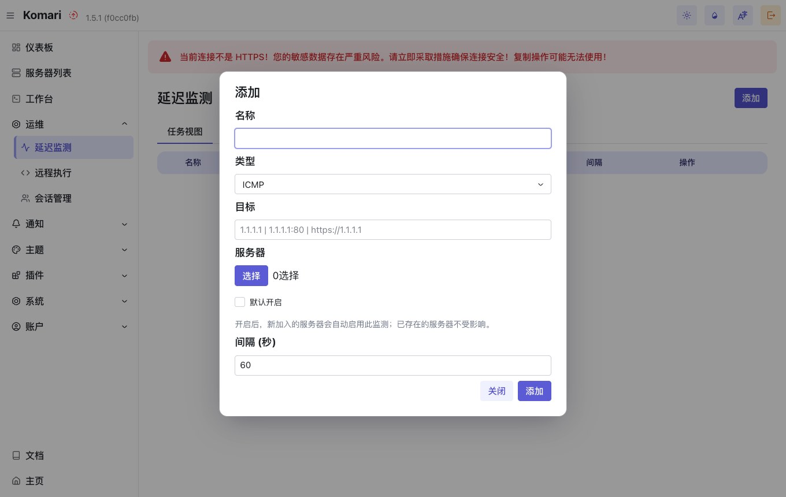 | 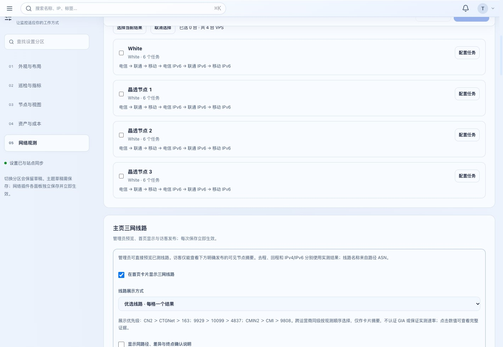 |

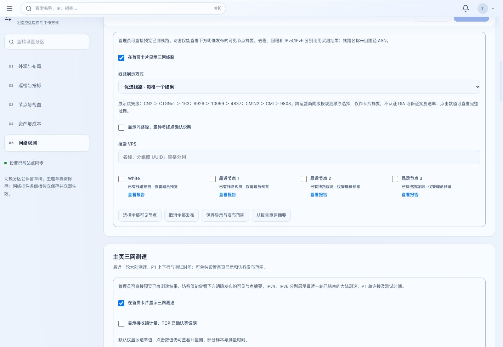

## 4. 创建并运行检测方案

1. 进入 **网络观测 → 检测方案**。点击「新建方案」后填写名称，第一次可用「单台 VPS 冒烟测试」。
2. 在「模块与预设」选择初始模块。建议先用 **国际连通** 或 **IP质量检测**，选一个可访问的目标和一个支持的地址族。对需要多目标的方案，按界面选择地区、运营商、方向、协议、地址族和测量点。
3. 在「定时时间」配置固定间隔或按时段运行。按日可指定 IANA 时区和一个或多个时刻，完整检测还可添加每周或每 N 天规则。只需试跑时，保存后点击「立即检测」，完成后可暂停方案。切换到「VPS 与覆盖」选一台已上线探测器的 VPS，或指定现有 Komari 分组；启用继承时，组内节点变动会影响未来任务。
4. 点击「预览每台 VPS 的覆盖」检查覆盖与容量，解决没有合格执行端、目标缺失或范围过大的提示。保存后用方案卡片的 **立即检测** 启动一轮。实例的「网络检测」页也能针对当前 VPS 运行已关联的方案。
5. 到 **实例 → 网络检测** 验证轮次。查看「已完成」「部分完成」「失败」和具体原因。确认结果及流量消耗合适后再增加目标、VPS 或开启定时。

| 模块、目标与地址族 | 调度、范围与覆盖预览 |
| --- | --- |
| 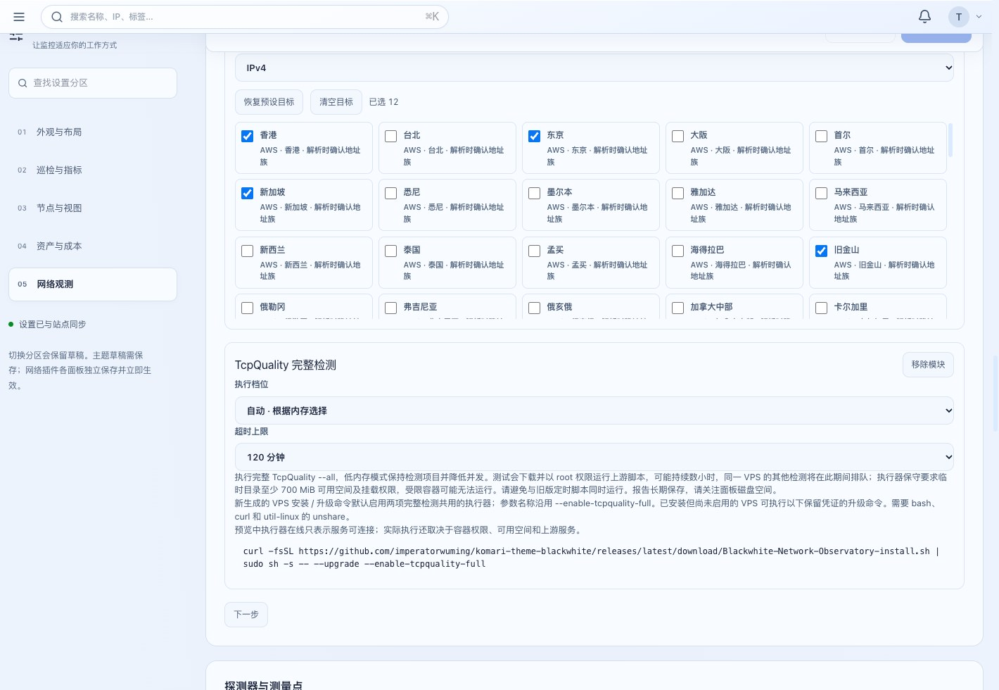 | 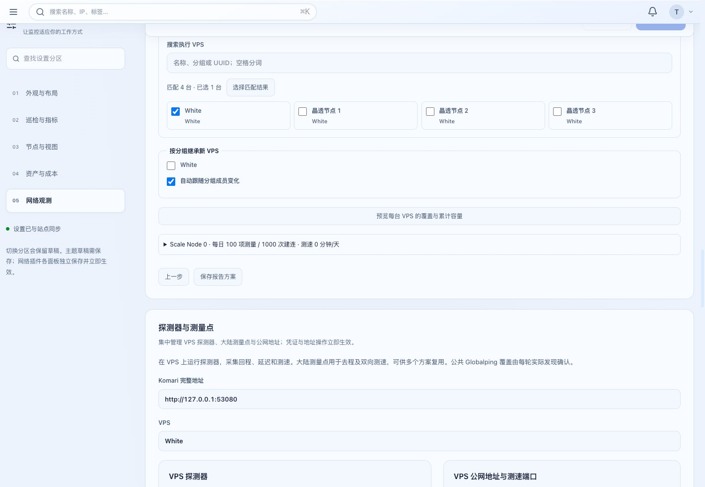 |

| 想测什么 | 选择什么 |
| --- | --- |
| 国际站点、IDC 的连通性 | 国际连通或 IDC 模块，按地区挑少量 TCP / HTTP 端点。状态与精确错误会保留 |
| 大陆去程、回程 | 大陆路由。VPS 发起到大陆的回程；自建大陆测量点或公共测量资源提供去程。按实际线路与 ASN 解读，目标标签只是意图 |
| 大陆、国际上下行吞吐 | 大陆单连接、泰尔公共测速（实验）或国际单连接。初次选少量目标并接受流量估算。P1 单连接是首页摘要口径 |
| TCP 连接质量或公开 BGP | 大陆 TCP 质量和全球 BGP 路径快照。SYN 需要 nping 与相应能力；公开 BGP 使用公网地址 |
| IP 与可访问性 | IP质量检测、流媒体和AI解锁检测，分别生成并归档双栈结果 |
| 综合基准 | TcpQuality 完整检测、NodeQuality 完整检测，详见[完整报告](../docs/network-reports.md#完整检测) |

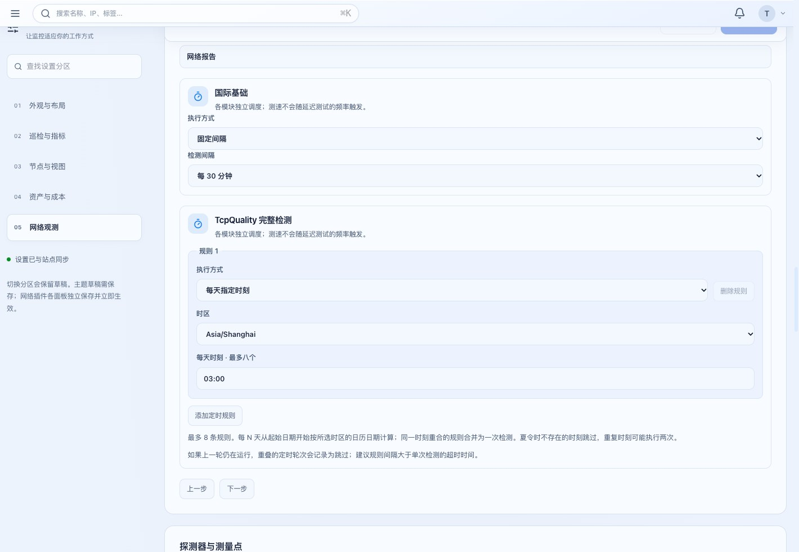

## 5. 选配大陆测量点和自建端点

- **大陆测量点**。在「探测器与测量点」登记名称、所在城市和运营商，再生成独立凭证。把生成的含 `--probe-id` 的命令拿到该网络内的 Linux 设备运行，按提示输入测量点密钥。它需要出站 HTTPS，可以在 NAT 后主动领取任务。在线后在方案里显式选择该测量点。
- **自建目标**。打开「目标端点」，填写名称、用途、授权说明、协议、地址与端口；保存后回到方案选择它。HTTP 测速需要相应下载／上传端点，自建 iperf3 要启动自己的服务并让测试双方能访问其端口。对公网产生流量前设置时长、载荷上限和访问范围。
- 普通 VPS 安装只需出站连接。主动接收测试（例如大陆测量点向 VPS 跑受控吞吐）才需要允许相应测试端口。依据界面提供的认证要求操作，并把防火墙来源限制为测量方。公共测速没有自建入站端口要求。

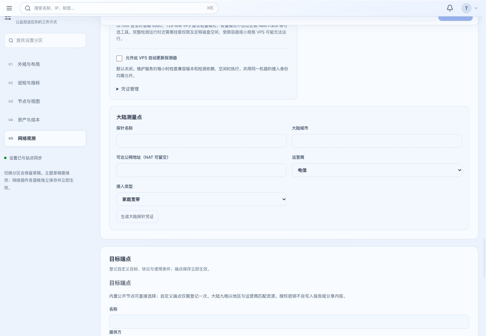

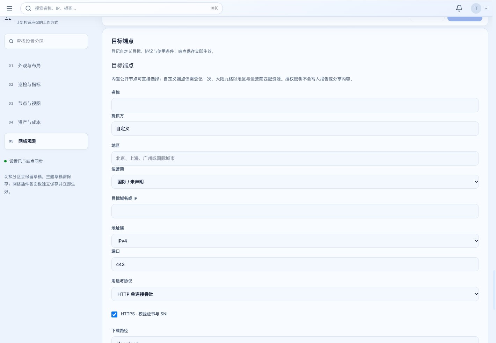

## 6. 首页 IP 能力、流量周期与报告

- **主页流量重置**。按 VPS 启用，探测器从正在运行的 Komari Agent 读取 `--month-rotate`，按 VPS 的本地日期计算。未设置月重置或进程参数不可读时显示「暂无重置周期」。
- **主页 IP 能力**。创建 IP 质量、流媒体和 AI 解锁方案，执行一轮。再到此面板启用、选择显示节点，按需设置初始展开。卡片可在 IPv4 / IPv6 间切换。需要 Bash、curl、jq、Python 3、bc 和 dig，并允许访问检测服务。供应商无结果时卡片显示缺测或 Lite 状态。
- **历史报告**。到实例查看轮次、证据和趋势。管理员先审阅原始结果的 IP、地区和第三方报告链接，再导出或分享。导出操作见[网络报告使用指南](../docs/network-reports.md)。

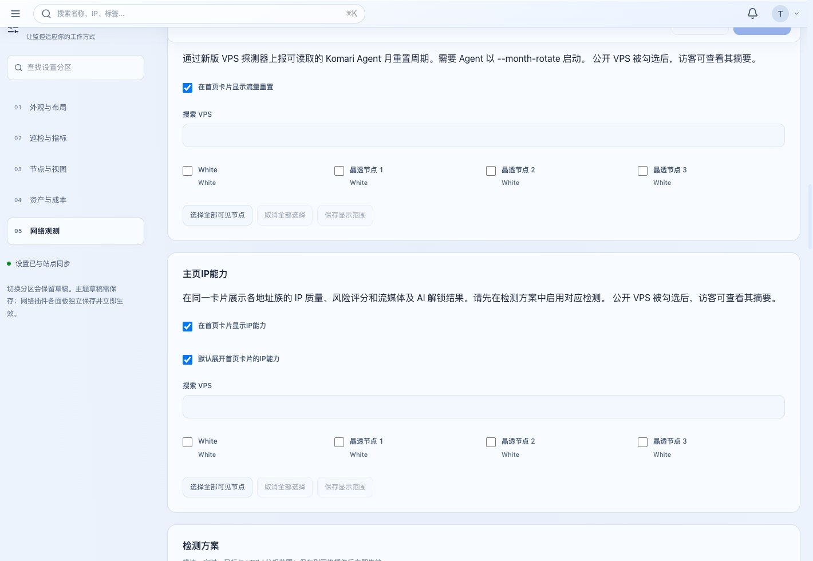

## 7. 故障检查

| 现象 | 按顺序核对 |
| --- | --- |
| 工作室提示插件不可用 | 检查插件已启用且状态正常；查看 Komari 插件日志，并确认反向代理保留了 API 路径 |
| 探测器等待连接或离线 | 核对 HTTPS 域名、证书、系统时间和公网出站；再确认节点 UUID 和探测器密钥来自同一面板，检查系统服务日志 |
| 401 | 密钥错误或已被重置。复查面板和节点身份，必要时按「凭证管理」重置并重新写入 |
| LXC 出现 `can't fork` | 对比输出的 `pids.current` 和 `pids.max`，也检查父 cgroup 和主机进程限制。资源限额由容器宿主机或服务商调整 |
| IPv6、去程或某城市缺测 | 检查对应地址族可用性、选定城市或运营商是否有匹配测量点、端点是否在线，以及使用的协议有无权限 |
| 卡片还是空的 | 先到实例看所选模块有没有已结束轮次，再核对 Ping 绑定、对应首页开关与发布节点；必要时在显示面板重建摘要 |
| 完整检测失败或排队 | 检查特权执行器和临时磁盘空间。先停止同机冲突测试，查看该轮次诊断。不建议在极低内存的主机执行完整检测 |

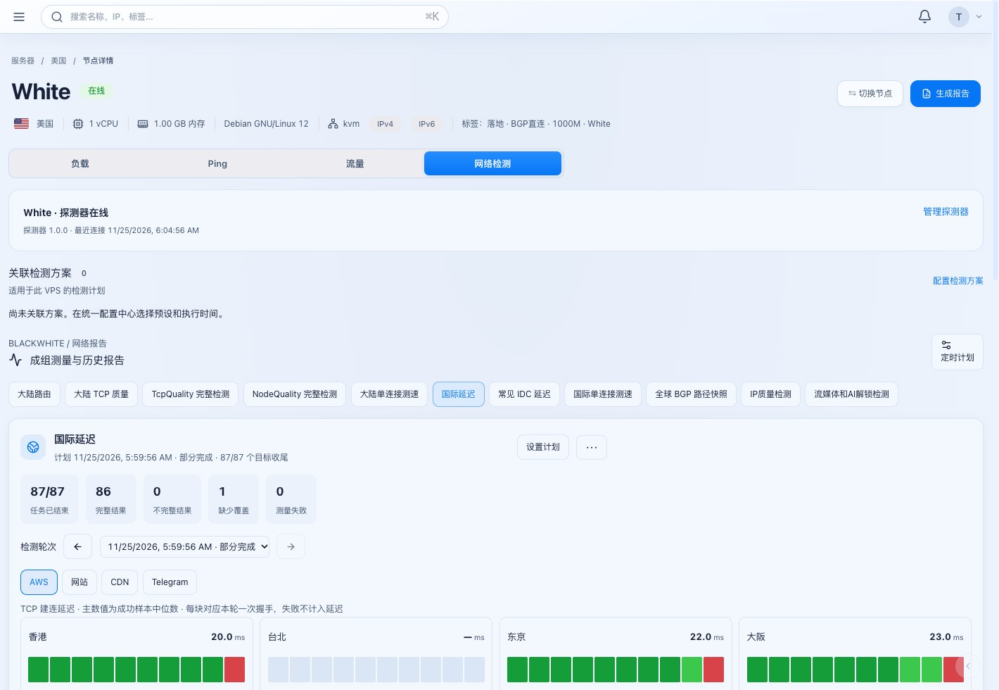
